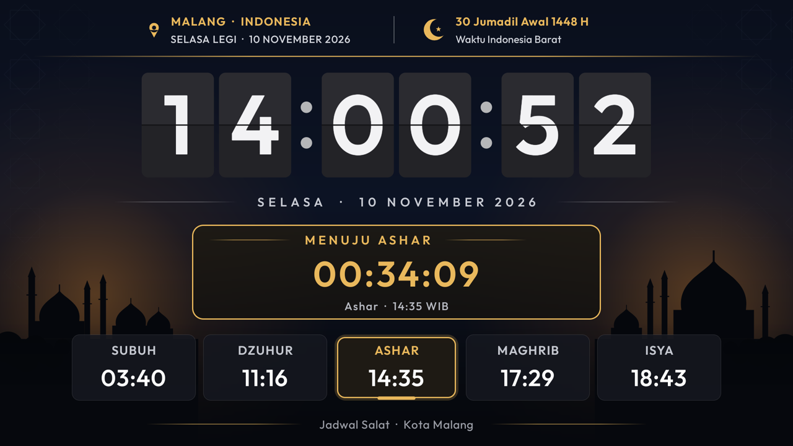
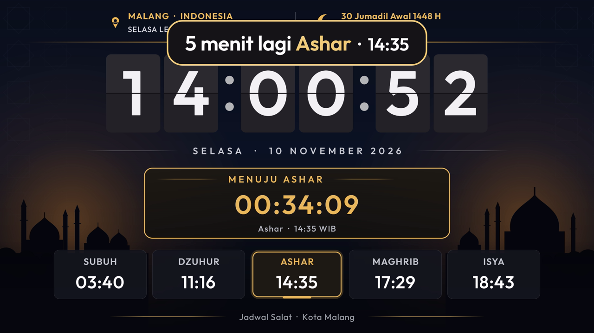

# Glass TV untuk Sony BRAVIA 4K GB — Jadwal Sholat, Jam Flip & Adzan

Ubah TV Sony BRAVIA (Android TV 9) menjadi papan jadwal sholat:

- Screensaver jam flip besar yang terbaca dari jauh.
- Hitung mundur ke waktu sholat berikutnya.
- Nada pengumuman 5 menit sebelum adzan, lalu suara adzan.
- Home Google TV bawaan yang penuh iklan diganti launcher kaca yang ringan.

**Langsung pakai:** APK sudah jadi, termasuk suara adzan. Cukup jalankan satu skrip dari PC Windows. Tidak perlu root dan tidak perlu build, sekitar 10 menit, dan bisa dikembalikan seperti semula dengan satu skrip.

Repo ini kelanjutan dari [Mibox-Glass-TV](https://github.com/pututjr/Mibox-Glass-TV), disesuaikan dan diuji pada **Sony BRAVIA 4K GB** (`BRAVIA_ATV2_PA`, Android 9, chipset MediaTek). Bisa juga dicoba di Android TV lain dengan Android 8 ke atas.

| Screensaver | Pengingat 5 menit sebelum adzan |
| --- | --- |
|  |  |

## Fitur

- **Screensaver jadwal sholat**:
  - Kota, hari + pasaran Jawa (mis. *Selasa Legi*), dan tanggal Hijriyah.
  - Jam flip besar `HH:MM:SS` yang angkanya membalik tiap detik.
  - Kotak hitung mundur *MENUJU ASHAR 00:41:27*, dan lima kartu waktu sholat dengan waktu berikutnya disorot emas.
  - Latar biru malam dengan siluet masjid. Isi layar bergeser sedikit tiap menit agar tidak burn-in.
- **Jadwal sholat** dihitung di TV tanpa internet, dengan kriteria Kemenag: Subuh 20°, Isya 18°, Ashar Syafi'i, ihtiyat +2 menit. Kota bisa diganti saat memasang.
- **Pengingat 5 menit sebelum adzan**:
  - Nada pengumuman ala stasiun disusul suara *"waktu sholat tiba"*.
  - Pil *"5 menit lagi Ashar · 14:35"* berkedip selama 30 detik di atas aplikasi apa pun (YouTube, Netflix, siaran TV, HDMI) dan juga di screensaver.
- **Adzan** (rekaman *Adzan Kurdi*) untuk Dzuhur, Ashar, Maghrib dan Isya. Subuh sengaja dilewati karena TV kantor belum menyala saat Subuh. Video yang sedang diputar dijeda, dan panel *"Waktu Ashar"* tampil. Tekan **OK** atau **Back** untuk menghentikan adzan.
- **TV menyala dan mati otomatis** (misalnya 06:30–19:30) memakai *On timer* bawaan Sony.
- **Aman:** TV otomatis dicadangkan dulu. Launcher bawaan hanya dimatikan, tidak dihapus.

## Isi repo

| File | Fungsi |
| --- | --- |
| `apk/glass-tv-sony.apk` | APK siap pakai: Glass TV + jadwal sholat + adzan (≈ 3 MB) |
| `pasang-sony.ps1` | Memasang semuanya ke TV: unduh adb bila perlu, backup otomatis, pasang APK, atur kota, Home, screensaver, dan izin adzan |
| `backup-sony.ps1` | Mencadangkan kondisi TV (hanya membaca). Dipanggil otomatis oleh `pasang-sony.ps1` |
| `restore-sony.ps1` | Mengembalikan TV ke kondisi saat backup |
| `glass-tv-sony.patch` | Kode sumbernya, untuk yang ingin build sendiri (lihat bagian akhir) |

## Langkah 1 — Siapkan TV

1. Buka **Settings → Device Preferences → About**.
2. Arahkan ke **Build**, lalu tekan OK di remote 7 kali sampai muncul *"You are now a developer"*.
3. Buka **Device Preferences → Developer options**, lalu nyalakan **USB debugging**. Kalau ada **Network debugging**, nyalakan juga.
4. Catat IP TV di **Settings → Network & Internet**. Contoh: `192.168.1.5`.

TV dan PC harus berada di jaringan yang sama (Wi-Fi atau LAN).

## Langkah 2 — Unduh repo ini

Klik **Code → Download ZIP** di halaman GitHub ini, lalu ekstrak, misalnya ke `D:\Sony-BRAVIA-4K-GB`. Bisa juga dengan Git:

```bash
git clone https://github.com/pututjr/Sony-BRAVIA-4K-GB.git
```

## Langkah 3 — Pasang ke TV

Buka **PowerShell**, lalu jalankan. Ganti IP dengan IP TV Anda.

```powershell
cd D:\Sony-BRAVIA-4K-GB
powershell -ExecutionPolicy Bypass -File pasang-sony.ps1 -TvHost 192.168.1.5
```

Pada percobaan pertama, TV menampilkan **Allow USB debugging?** Centang **Always allow from this computer**, tekan OK, lalu jalankan perintahnya sekali lagi.

**Kota lain (default Malang):** tambahkan nama kota dan koordinatnya. Koordinat bisa diambil dari Google Maps dengan klik kanan pada kota.

```powershell
powershell -ExecutionPolicy Bypass -File pasang-sony.ps1 -TvHost 192.168.1.5 -Kota Jakarta -Lat -6.2088 -Lng 106.8456
```

| Kota | `-Lat` | `-Lng` |
| --- | --- | --- |
| Jakarta | -6.2088 | 106.8456 |
| Surabaya | -7.2575 | 112.7521 |
| Bandung | -6.9175 | 107.6191 |
| Yogyakarta | -7.7956 | 110.3695 |
| Semarang | -6.9667 | 110.4167 |
| Medan | 3.5952 | 98.6722 |
| Makassar | -5.1477 | 119.4327 |

Skrip ini:

1. Mengunduh adb resmi dari Google bila belum ada di PC.
2. Membuat folder `backup-sony-<tanggal>` sekali saja, sebelum ada yang diubah.
3. Memasang APK dan menyimpan lokasi kota.
4. Menjadikan Glass TV sebagai Home. Launcher bawaan dimatikan, tidak dihapus.
5. Memasang screensaver jadwal sholat (muncul setelah 5 menit).
6. Memberi izin *tampil di atas aplikasi lain* untuk pengingat adzan.

Kalau ada langkah yang gagal, launcher bawaan otomatis dikembalikan.

**Cek:** keluar `Selesai. Home sekarang: com.gathin.tvhome/.MainActivity` dan `Pengingat/adzan berikutnya: ...`. Kalau volume TV terlalu kecil untuk adzan, skrip juga memberi peringatan.

## Langkah 4 — TV nyala dan mati otomatis (On timer Sony)

Aplikasi biasa tidak bisa menyalakan TV dari standby, jadi pakai timer bawaan Sony. Di remote, buka **Settings → Timers → On timer**:

| Pilihan | Isi |
| --- | --- |
| On timer | Nyala |
| Day | Every Mon-Fri (atau Every day) |
| Time | 06:30 |
| Duration | 13 h (TV mati pukul 19:30) |
| Volume setup | Volume saat TV menyala. Volume ini juga menentukan keras-pelannya adzan |

## Catatan khusus Sony

- **Screensaver paling cepat 5 menit.** Nilai di bawah itu diabaikan oleh TV Sony.
- **Jangan memasang ulang APK saat screensaver sedang tampil.** TV akan langsung standby. `pasang-sony.ps1` sudah membangunkan TV lebih dulu.
- **Volume adzan mengikuti volume TV.** Kalau volume speaker sangat kecil (misalnya 5 dari 100), adzan hampir tidak terdengar.
- Pengingat dan adzan hanya berjalan saat TV menyala, termasuk saat screensaver tampil.
- Tanggal Hijriyah memakai kalender Umm al-Qura, jadi bisa selisih sehari dengan kalender Kemenag. Pasaran dan tanggal Hijriyah berganti pukul 00:00.
- Setelah selesai, matikan **USB/Network debugging** bila jaringan dipakai banyak orang.

## Kembali ke semula

```powershell
cd D:\Sony-BRAVIA-4K-GB\backup-sony-<tanggal>
powershell -ExecutionPolicy Bypass -File restore-sony.ps1 -TvHost 192.168.1.5
```

Skrip ini:

- Menghapus Glass TV, termasuk alarm adzannya.
- Menyalakan lagi aplikasi yang dimatikan.
- Memulihkan launcher, screensaver, dan waktu tunggu screensaver seperti saat backup.

*On timer* Sony tidak diubah, jadi atur sendiri lewat menu bila perlu. Factory reset juga tetap bisa dipakai, karena tidak ada aplikasi sistem yang dihapus.

## Masalah umum

| Gejala | Solusi |
| --- | --- |
| `unauthorized` / `failed to authenticate` | Centang **Always allow** di TV, tekan OK, lalu ulangi perintah |
| `connection refused` / `offline` | TV sedang standby atau IP berubah. Nyalakan TV, cek USB debugging dan IP |
| `running scripts is disabled` | Jalankan lewat `powershell -ExecutionPolicy Bypass -File ...` seperti contoh di atas |
| Pengingat tidak muncul di atas aplikasi lain | Jalankan `pasang-sony.ps1` sekali lagi |
| Adzan terlalu pelan | Naikkan volume TV, atau atur *Volume setup* di On timer |
| TV hitam setelah pasang ulang APK | TV masuk standby karena screensaver dihentikan paksa. Nyalakan dengan remote |
| Tanggal Hijriyah beda sehari | Build sendiri dengan `hijri_offset_days` = `-1` atau `1` (lihat bawah) |

## Build sendiri (opsional)

Hanya perlu kalau ingin mengubah isi, misalnya mengganti rekaman adzan, mengubah dock aplikasi, atau menggeser tanggal Hijriyah. Butuh Git, JDK 17, dan Android SDK, dengan unduhan sekitar 650 MB. JDK 21/25 bawaan Android Studio **tidak** bisa dipakai, karena Gradle 8.9 butuh JDK 17.

**a. Alat** (PowerShell). Lewati yang sudah ada:

```powershell
$ProgressPreference='SilentlyContinue'; $dl="$env:TEMP\androiddl"; $sdk="$env:LOCALAPPDATA\Android\Sdk"
New-Item -ItemType Directory -Force $dl,$sdk,"$sdk\cmdline-tools" | Out-Null
Invoke-WebRequest "https://api.adoptium.net/v3/binary/latest/17/ga/windows/x64/jdk/hotspot/normal/eclipse" -OutFile "$dl\jdk17.zip"
Invoke-WebRequest "https://dl.google.com/android/repository/commandlinetools-win-11076708_latest.zip" -OutFile "$dl\clt.zip"
Expand-Archive "$dl\jdk17.zip" "$env:LOCALAPPDATA\jdk-tmp" -Force
Move-Item (Get-ChildItem "$env:LOCALAPPDATA\jdk-tmp" -Directory)[0].FullName "$env:LOCALAPPDATA\jdk17"
Expand-Archive "$dl\clt.zip" "$sdk\clt-tmp" -Force
Move-Item "$sdk\clt-tmp\cmdline-tools" "$sdk\cmdline-tools\latest"
```

Lalu di **Git Bash** (perintah `yes` menyetujui lisensi Android SDK dari Google):

```bash
export JAVA_HOME="$LOCALAPPDATA/jdk17"; SDK="$LOCALAPPDATA/Android/Sdk"
yes | "$SDK/cmdline-tools/latest/bin/sdkmanager.bat" --sdk_root="$SDK" --licenses
```

**b. Kode, patch, dan build** (Git Bash, dari folder repo ini). Build pertama memakan 3–5 menit.

```bash
git clone -c core.longpaths=true https://github.com/cocombee/glass-tv.git
cd glass-tv && git checkout -q ce164b6 && git apply ../glass-tv-sony.patch && echo "patch OK"
cd launcher
printf 'sdk.dir=%s\n' "$(cygpath -m "$LOCALAPPDATA/Android/Sdk")" > local.properties
export JAVA_HOME="$LOCALAPPDATA/jdk17"
./gradlew.bat testReleaseUnitTest assembleRelease -q --console=plain
```

Yang bisa diubah sebelum build:

- **Rekaman adzan:** `launcher/app/src/main/res/raw/adzan.mp3`
- **Nada pengingat:** `launcher/app/src/main/res/raw/pengumuman.ogg`
- **Kota default, dock aplikasi, dan `hijri_offset_days`:** `launcher/app/src/main/res/values/config.xml`

Setelah build, `pasang-sony.ps1` otomatis memakai `glass-tv\launcher\app\build\outputs\apk\release\app-release.apk` bila file itu ada.

| Gejala build | Solusi |
| --- | --- |
| Pesan versi Java | Pastikan `JAVA_HOME` mengarah ke JDK 17 |
| `classes.dex ... being used by another process` | Antivirus sedang memindai file build. Tunggu beberapa detik lalu build lagi |
| `git apply` gagal | Pastikan sudah `git checkout ce164b6` |

## Kredit dan lisensi

- Launcher: [Glass TV](https://github.com/cocombee/glass-tv) oleh cocombee, berdasarkan [Clean Your TV](https://github.com/Gathin23/cleanyourtv) oleh Gathin. Keduanya berlisensi MIT.
- Font Outfit berlisensi SIL OFL. Rumus posisi matahari mengikuti [PrayTimes.org](http://praytimes.org/), dengan parameter kriteria Kemenag RI.
- Tanggal Hijriyah memakai `android.icu.util.IslamicCalendar` (Umm al-Qura) bawaan Android. Pasaran Jawa memakai patokan 17 Agustus 1945 = Jumat Legi.
- Rekaman *Adzan Kurdi* disertakan agar bisa langsung dipakai dan disebarluaskan untuk dakwah.
- Patch, skrip, nada pengumuman, dan suara *"waktu sholat tiba"* berlisensi MIT, lihat [LICENSE](LICENSE).
